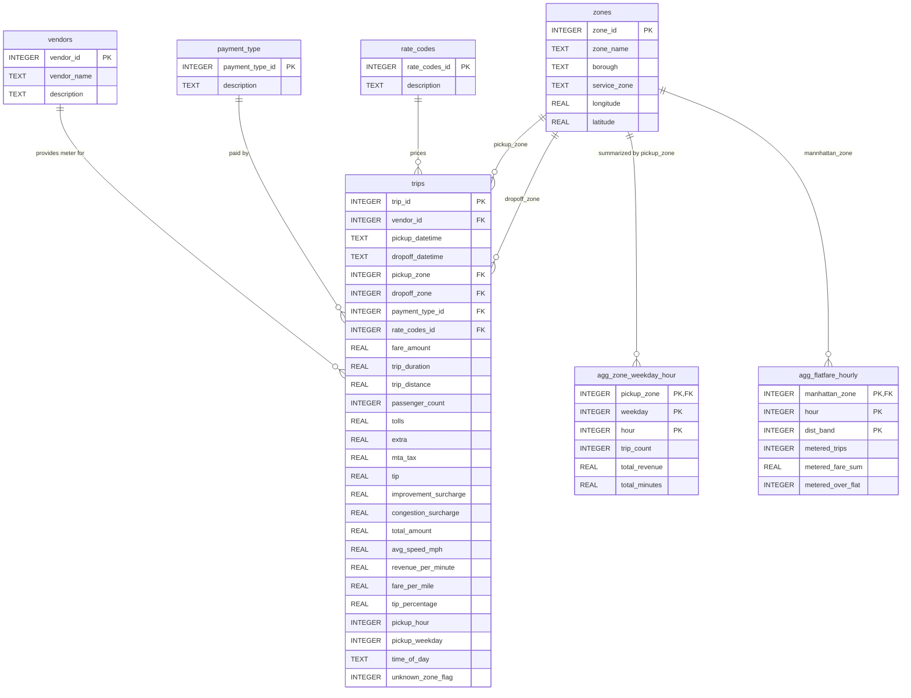

# G2_Urban-Mobility-Data-Explorer

## Database Design (ERD)
 
The database is SQLite. It uses one fact table (`trips`), four lookup tables, and two pre-aggregated tables that make dashboard queries fast. The schema is defined in `db/schema.sql`

### ER Diagram

### Data Dictionary 
SQLite has no dedicated datetime type, so timestamps are stored as ISO 8601 `TEXT` (`YYYY-MM-DD`, New York locla time, no timwzone). Money columns are in US dollars and distances are in miles.

#### `zones`

| Column | Type | Constraints| Description|
| --- | --- |--- |--- |
| `zone_id`| INTEGER |PK| TLC `LocationID` (1 to 265). Matches the zone IDs in the GeoJSON. |
| `zone_name` | TEXT || zone name, e.g ""JFK Airport. Blank for IDs 264 and 265 in the source file. |
| `borough` | TEXT || Borough: Manhattan, Queens, Brooklyn, Bronx, Staten Island, EWR, or Unknwon.|
| `service_zone` | TEXT || TLC service area grouping (e.g. Yellow Zone, Airports). |
| `longitude` | REAL || Longitude of the zone centroid (WGS84), used for map makers. |
| `latitude` | REAL ||Latitude of the zone centroid (WGS84). |

#### `payment_type` 

| Column | Type | Constraints | Description |
| --- |--- | ---| --- |
| `payment_type_id` | INTEGER | PK | TLC payment code: 1 = card, 2 = cash, 3 = no charge, 4 = dispute. |
| `description` | TEXT | NOT NULL | Readable name of the payment type. |

#### `rate_codes`

| Column | Type | Constraints | Description |
| --- | --- | --- | --- |
| `rate_codes_id`| INTEGER | PK | TLC rate code: 1 = standard, 2 = JFK flat fare, 3 = Newark, 4 = Nassau/Westchester, 5 = negotiated, 6 = group ride. |
| `description` | TEXT | NOT NULL | Readable name of the rate code. |

#### `vendors`

| Column | Type | Constraints | Description |
| --- | --- | --- | --- |
| `vendor_id` | INTEGER | PK | TLC vendor code: 1 = Creative Mobile Technologies, 2 = VeriFone. |
| `vendor_name` | TEXT | NOT NULL | Vendor name. |
| `description` | TEXT | NOT NULL | Short description of the vendor (the meter provider). |

#### `trips`
| Column | Type | Constraints | Description |
| --- | --- | --- | --- |
| `trip_id` | INTEGER | PK | Surrogate key for the trip. |
| `vendor_id` | INTEGER | FK to `vendors` | Meter provider that recorded the trip. |
| `pickup_datetime` | TEXT NOT NULL | Meter start time (ISO 8601, NY local time). |
| `dropoff_datetime` | TEXT NOT NULL, must be later than pickup | Meter stop time.
| `pickup_zone` | INTEGER | NOT NULL, FK to `zones` | Zone where the trip started. |
| `dropoff_zone` | INTEGER | NOT NULL, FK to `zones` | Zone where the trip started. |
| `payment_type_id` | INTEGER | NOT NULL, FK to `payment_type` | How the rider paid. Cash tips are not recorded, spo tip analysis uses card trips only. |
| `rate_codes_id` | INTEGER | NOT NULL, FK to `rate_codes`  | Rate code in effect (code 2 is the JFK flat fare). |
| `fare_amount` | REAL  | NOT NULL, > 0 |  Time-and-distance fare from the meter.
| `trip_duration` | REAL | NOT NULL | Trip length in minutes (dropoff minus pickup). Derived. |
| `trip_distance` | REAL | NOT NULL, 0 to 100  | Distance in miles from the meter. |
| `passenger_count` | INTEGER | nullable | Passengers, entered by the driver. |
| `tolls` | REAL | nullable | Tolls paid on the trip.
| `extra` | REAL | nullable | Extras and surcharges (rush hour and overnight charges). |
| `mta_tax` | REAL | nullable | Metropolitan Transportation Authority tax. |
| `tip` | REAL | nullable | Tip amount. Always 0 for cash trips because cash trips are not recorded.
| `improvement_surcharge` | REAL | nullable | Per_trip improvement surcharge. |
| `congestion_surcharge` | REAL | nullable | Empty Jnuary 2019, because the charge began later. |
`total_amount` REAL nullable Total charged to the rider, excluding cash tips.
`avg_speed_mph`REAL  nullable  Average speed: distance divided by durartion in hours. Derived. Congestion indicator and outlier check.
`revenue_per_minute` REAL nullable Driver earnings per minute: (`total_amount`, minus `tolls`) divided by `trip_duration`. Derived.
`fare-per-mile` REAL nullable `fare_amount` divided by `trip_distance`. Derived. Null when distance is 0.
`tip_percentage` REAL  nullable `tip` divided by `fare_amount`, for card trips only. Derived.
`pickup_hour` INTEGER NOT NULL, 0 to 23 Hour of the pickup time. Derived.
| `pickup_weekday` | INTEGER NOT NULL, 1 to 7 Day of week of the pickup. Derived.  
| `time_of_day` |TEXT NOT NULL, one of `night`,  `morning_rush`, `midday`, `evening_rush`, `evening` | Time-of-day bucket for the pickup hour. Derived. |
| `unknown_zone_flag` | INTEGER | NOT NULL, 0 or 1 | 1 if the pickup or dropoff zone is an unknown or outside-NYC zone (IDs 264 and 265), otherwise 0. |

### Normalization (3NF) Justification

- **1NF:** every column holds a single atomic value, and every table has a primary key.
- **2NF:** each non-key column depends on the whole key. The tables with composite keys are the two `agg_*` tables, every measure in them describes the full combination of the key columns.
- **3NF:** trips store only IDs for zones, vendors, payment types, and rate codes. Zone names, boroughs, and descriptions live only in their own tables, so no non-key column depends on another non-key column.
- **Deliberate denormalization:** `pickup_hour`, `pickup_weekday`, `time_of_day`, and the other derived metrics are stored in `trips` even though they can be computed from the timestamps. Precomputing them speeds up filtering and grouping, and the aggregate tables avoid scanning millions of rows. The cost is extra storage and refresh step after each data load.
- **Integrity:** primary keys, foreign keys, and CHECK constraints (positive fares, distance of 0 to 100 miles, dropoff after pickup, valid hour and weekday ranges) keep bad dat ou t of the databas. SQLite only enforces foreign keys if you run `PRAGMA foreign_keys = ON;` on every connection.